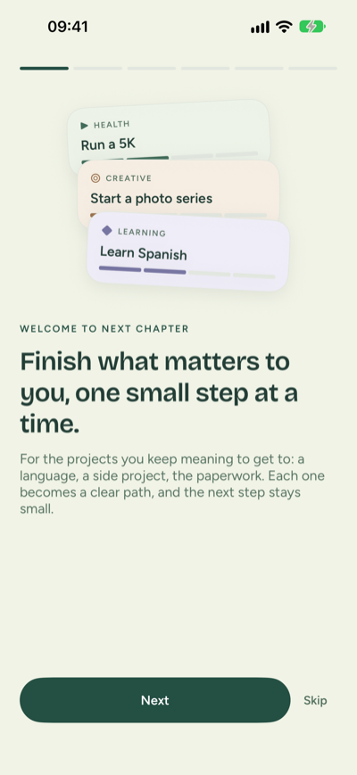
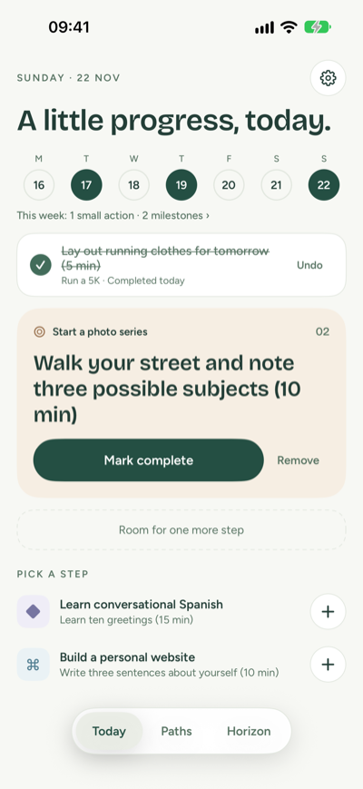
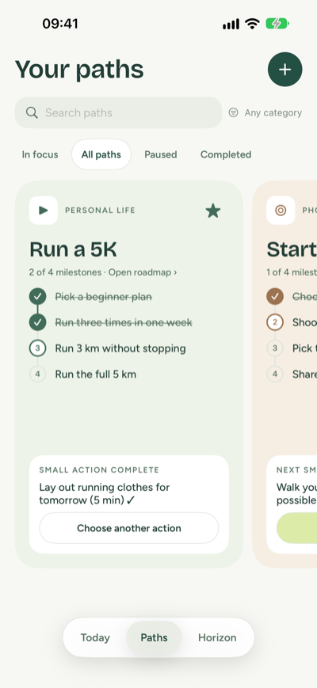
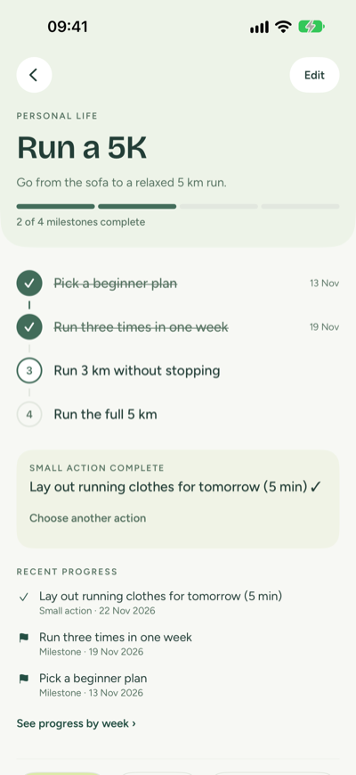
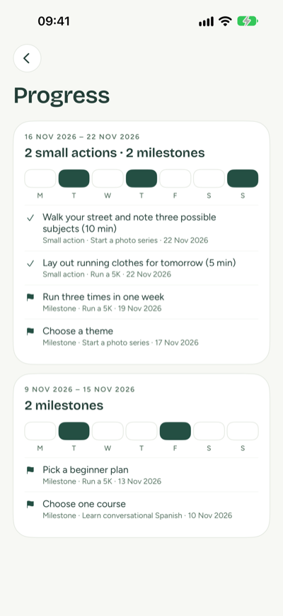

# Next Chapter: Project Map

**One small step per project.**
An iPhone app for the projects that occupy your head.

---

  
  
  
  
  

## What it does

Next Chapter turns each project you keep meaning to get to (a language, a 5K, something of your own) into a **path**:
the bigger milestones, plus one small action you can do in 5–15 minutes.

- **Up to three steps a day.** Anything you don't get to just waits.
- **You decide what counts.** Nothing is ticked off unless you say so.
- **Look back at your weeks**, and get a "chapter complete" moment when a path is done.
- **Keep a few paths in focus.** Pause others, or park them on the Horizon.
- **Home-screen widget** for today's steps.
- **No pressure by design.** No points, no streaks, no nagging reminders.

## Privacy

No account, no ads, no analytics, no tracking. Your data stays on your iPhone, and in your private iCloud if you turn on sync.
[Privacy policy](https://sepehr.digital/apps/next-chapter/privacy/) · [Support](https://sepehr.digital/apps/next-chapter/)

## About

A spare-time project, built in SwiftUI (iOS 17+, iPhone), mostly with AI coding agents.
This repository is a showcase. The source code is not public.

Made by [Sepehr](https://sepehr.digital).
